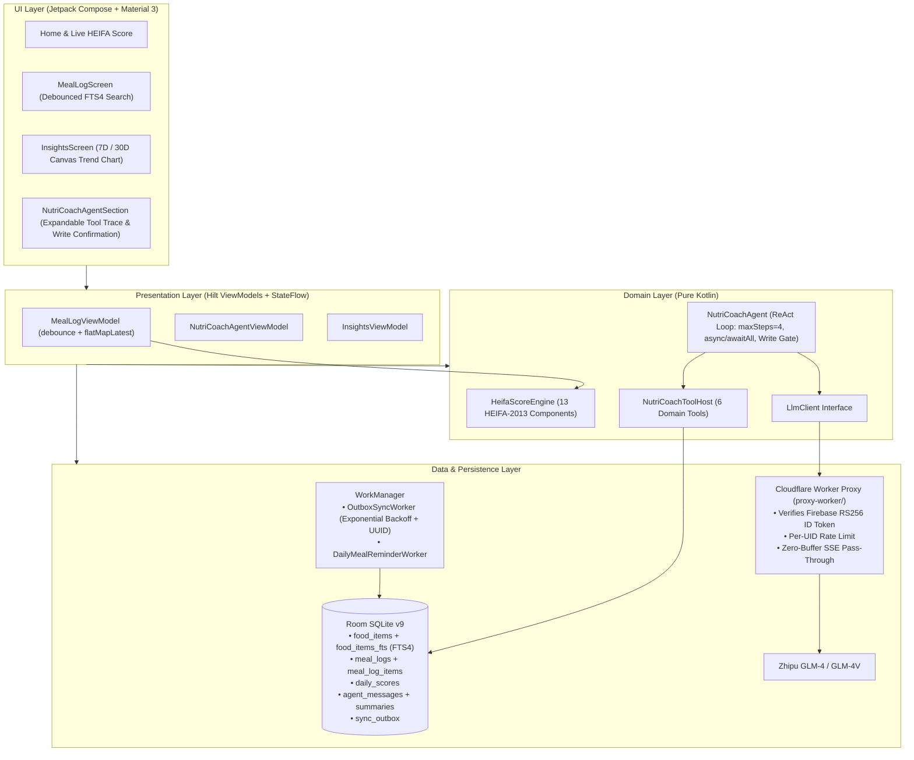

# NutriTrack

An Android nutrition-tracking app and **ReAct AI Nutrition Agent**, built with
Jetpack Compose, Hilt, Room (FTS4 + relational transactions), WorkManager, Retrofit (SSE),
Firebase, and a Cloudflare Worker JWT proxy.

> **Interview / Demo Quickstart:** Build and install the self-contained **`demo` flavor**
> (`./gradlew assembleDemoDebug`). It launches directly into a pre-seeded persona
> (*Alex Rivera*) with **30 days of meal logs, HEIFA-2013 score trend charts, expandable
> ReAct tool-call traces, meal-plate vision scanning, and an offline `FakeLlmClient`** —
> no API key, account registration, or network connection required.

---

## Architecture Overview



---

## Key Engineering Highlights

| Area | Implementation |
|---|---|
| **Food Logging & FTS4 Search** | 34-item AGTHE nutrition catalog (`assets/food_catalog.json`) indexed by an `@Fts4` virtual table (`food_items_fts`); relational `meal_logs` + `meal_log_items` with `CASCADE`/`RESTRICT` foreign keys and `@Transaction` queries; search input uses `debounce(150ms)` + `flatMapLatest` |
| **Pure-Kotlin HEIFA-2013 Engine** | [`HeifaScoreEngine.kt`](app/src/main/java/com/songshawn/nutritrack/domain/scoring/HeifaScoreEngine.kt) calculates all 13 Australian dietary-quality components (vegetable/fruit serves & sub-category variety, total/whole grains, meat, dairy, water, unsaturated/saturated fat %, sodium, added sugar %, alcohol, discretionary foods) with zero Android dependencies |
| **ReAct Tool-Calling Agent** | [`NutriCoachAgent.kt`](app/src/main/java/com/songshawn/nutritrack/domain/agent/NutriCoachAgent.kt) implements a bounded coroutine ReAct loop (`maxSteps = 4`, `25s` timeout, `async`/`awaitAll` parallel read-tool execution, and a human-in-the-loop confirmation barrier before `log_meal` writes to Room) |
| **Meal-Plate Vision → JSON** | [`ZhipuLlmClient.kt`](app/src/main/java/com/songshawn/nutritrack/domain/agent/ZhipuLlmClient.kt) downscales captured photos to `<=768px`, extracts structured meal items & servings as JSON, aligns them with the FTS4 catalog, and stages a one-tap confirmation card |
| **Room Conversation Memory** | [`AgentConversationRepository.kt`](app/src/main/java/com/songshawn/nutritrack/data/repository/AgentConversationRepository.kt) stores multi-turn chat and tool-call traces (`agent_messages`) and automatically compacts older turns into `agent_session_summaries` |
| **Cloudflare Worker JWT Proxy** | [`proxy-worker/src/index.ts`](proxy-worker/src/index.ts) verifies Firebase Auth RS256 ID tokens against Google JWKS, enforces per-UID sliding-window rate limits, holds `ZHIPU_API_KEY` in Worker secrets, and streams SSE responses; release APKs enable R8 (`isMinifyEnabled = true`) and embed zero API keys |
| **Transactional Outbox & Concurrency** | [`CloudSyncRepository.kt`](app/src/main/java/com/songshawn/nutritrack/data/repository/CloudSyncRepository.kt) + [`OutboxSyncWorker.kt`](app/src/main/java/com/songshawn/nutritrack/worker/OutboxSyncWorker.kt) stage Firestore writes in Room (`sync_outbox`) with deterministic `UUID.nameUUIDFromBytes` IDs and exponential backoff; SSE token streams are coalesced via [`throttleChunks(48ms)`](app/src/main/java/com/songshawn/nutritrack/util/StreamChunkThrottler.kt) (reducing UI recompositions by >88%) |

---

## Architecture Decision Records & AI Workflow

- **AI-Assisted Engineering Workflow & Real Bug Case Studies:** [`docs/ai-workflow.md`](docs/ai-workflow.md)
- **Agent Guardrails:** [`CLAUDE.md`](CLAUDE.md) / [`AGENTS.md`](AGENTS.md)
- **Roadmap:** [`docs/roadmap.md`](docs/roadmap.md)
- **ADRs:**
  - [ADR 0001: Cloudflare Worker Proxy with Firebase ID Token Verification](docs/adr/0001-cloudflare-worker-firebase-jwt-proxy.md)
  - [ADR 0002: Coroutine ReAct Tool-Calling Agent with Write-Confirmation Gate](docs/adr/0002-react-tool-calling-agent-over-prompt-stuffing.md)
  - [ADR 0003: Transactional Outbox Pattern with Deterministic UUIDs for Cloud Sync](docs/adr/0003-transactional-outbox-and-deterministic-uuids.md)

---

## Building, Testing & Coverage

Requirements: JDK 17+ (or JDK 21) and Android SDK (`compileSdk 36`).

```bash
# 1. Build offline-ready Demo APK (30-day seeded history + FakeLlmClient, no API key needed)
./gradlew assembleDemoDebug

# 2. Build Production Debug & R8-minified Release APKs
./gradlew assembleProdDebug assembleProdRelease

# 3. Run unit tests (HEIFA engine, ReAct agent loop, 12-case tool eval benchmark, MockWebServer SSE, Turbine StateFlow, stream throttler)
./gradlew testProdDebugUnitTest testDemoDebugUnitTest

# 4. Run static analysis (Detekt + Android Lint) & Kover coverage report
./gradlew detekt lintProdDebug koverXmlReportProdDebug
```

Optional `local.properties` configuration for live cloud LLM calls in `prod` builds:

```properties
llm.proxyUrl=https://nutritrack-llm-proxy.<your-subdomain>.workers.dev/
```

---

## Provenance

NutriTrack started as an assignment for a mobile-development course at Monash
University. The course provided the HEIFA dataset (`app/src/main/assets/data.csv`) and
the original feature brief (login by patient ID, questionnaire, score screens,
NutriCoach and the clinician dashboard). The coursework version is the first commit in
this repository (September 2025).

Everything after that is my own extension of the project: the Hilt migration, food
catalog & FTS4 meal logging, the pure-Kotlin HEIFA-2013 scoring engine, Room migrations
(6 → 7 → 8 → 9) with exported schemas, the ReAct tool-calling agent & evaluation benchmark,
the Cloudflare Worker JWT proxy, the transactional outbox sync, and the offline `demo` flavor.

## License

[MIT](LICENSE)
